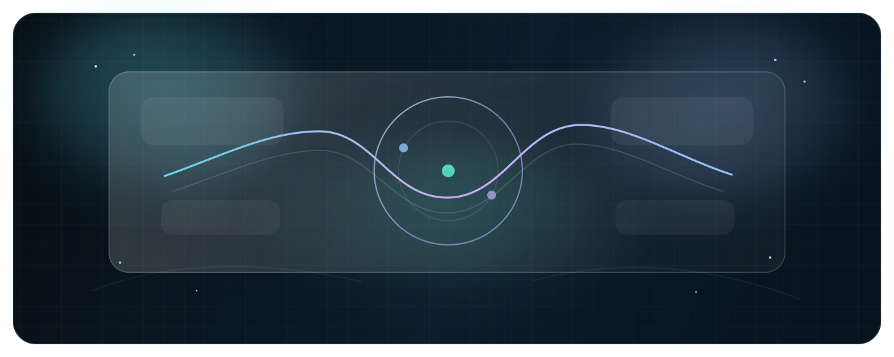

  

<h1 align="center">Ujala Agarwal</h1>

  <strong>Software developer building cloud-aware web products, AI-assisted developer tools, and interfaces designed to be explored—not merely described.</strong>

  The work here focuses on a practical engineering standard: clear user journeys, inspectable technical decisions, honest product boundaries, and live demos backed by source.

  
  
  
  

## Engineering focus

I build end-to-end product surfaces where the engineering is easy to evaluate: frontend workflows, server-side APIs, deployment configuration, source-backed explanations, and release checks sit together in the open.

- **Full-stack product delivery** — responsive interfaces paired with Node.js and Express service layers.
- **AI-assisted workflows** — practical systems for knowledge transformation and repository understanding, with evidence and fallback paths made explicit.
- **Cloud-aware architecture** — serverless AWS design across auth, APIs, storage, OCR, and data flows; public demos keep credentials and private data out of the browser.
- **Quality as a feature** — clear demo/production boundaries, source-linked reasoning, automated checks, and deployment-ready documentation.

## Selected work

<table>
  <tr>
    <td width="50%" valign="top">
      <h3>LumenStack AI</h3>
      
<strong>Repository understanding for engineers and reviewers.</strong>

      
A full-stack workspace that accepts a Git URL or ZIP archive, maps code structure, presents source-linked explanations and architecture views, and provides a guided path for understanding and explaining an unfamiliar codebase. Optional AI assistance is paired with a deterministic fallback; quality, smoke, site, and security checks are visible in source.

      
<code>Node.js</code> <code>Express</code> <code>Static analysis</code> <code>Mermaid</code> <code>GitHub Actions</code>

      
<a href="https://lumenstack-ai.onrender.com/"><strong>Live workspace</strong></a> · <a href="https://lumenstack-ai.onrender.com/case-study.html">Case study</a> · <a href="https://github.com/agarwalujala3-lang/LumenStack-AI">Source</a>

    </td>
    <td width="50%" valign="top">
      <h3>AtlasIQ Ops</h3>
      
<strong>AI-powered knowledge transformation for dense internal material.</strong>

      
A multi-page product for turning text-based policy, onboarding, and learning content into structured summaries, concept views, flashcards, quizzes, review prompts, saved workspaces, and portable exports. The public deployment serves the frontend and API through one Render application.

      
<code>JavaScript</code> <code>Node.js</code> <code>Express</code> <code>OpenAI-backed generation</code> <code>Render</code>

      
<a href="https://atlasiq-ops-platform.onrender.com/"><strong>Live product</strong></a> · <a href="https://github.com/agarwalujala3-lang/Atlasiq-Ops-Platform">Source</a>

    </td>
  </tr>
  <tr>
    <td width="50%" valign="top">
      <h3>ReceiptPulse</h3>
      
<strong>Demo-first receipt intelligence with a reconnectable AWS path.</strong>

      
A public, recruiter-safe workflow for receipt upload, OCR-style field extraction, duplicate review, search, and spend analytics. The live experience clearly separates browser-local demo data from the documented AWS architecture for Cognito, API Gateway, Lambda, S3, DynamoDB, and Textract.

      
<code>AWS</code> <code>Textract</code> <code>Lambda</code> <code>Cognito</code> <code>Dashboard UX</code>

      
<a href="https://receiptpulse-cloud-demo.onrender.com/"><strong>Live demo</strong></a> · <a href="https://github.com/agarwalujala3-lang/ReceiptPulse">Source</a>

    </td>
    <td width="50%" valign="top">
      <h3>Ujala Portfolio OS</h3>
      
<strong>A proof-driven portfolio built as a product surface.</strong>

      
A multi-page portfolio system that brings together live projects, engineering trade-offs, resume routing, recruiter-focused storytelling, and GitHub-backed project proof. It is deployed from a repeatable static-site build pipeline on Render.

      
<code>HTML</code> <code>CSS</code> <code>JavaScript</code> <code>Static build pipeline</code> <code>Render</code>

      
<a href="https://ujala-portfolio.onrender.com/"><strong>Live portfolio</strong></a> · <a href="https://github.com/agarwalujala3-lang/ujala-portfolio">Source</a>

    </td>
  </tr>
</table>

## What a reviewer can verify

| Signal | Where to inspect it |
| --- | --- |
| Product execution | Live deployments, user flows, responsive UI states, and project documentation |
| Backend ownership | Express routes, API contracts, service boundaries, server-side configuration, and deployment files |
| Practical AI use | Source-grounded repository exploration, optional AI assistance, and AI-powered knowledge workflows |
| Cloud judgment | AWS architecture paths, safe public demo modes, no static secret exposure, and configuration-led live integration |
| Engineering discipline | README boundaries, smoke and regression scripts, GitHub Actions, audit commands, and visible trade-offs |

## Working principles

- Build the path a real user would follow, not just an attractive landing page.
- Make claims traceable: link to the live product, source, documentation, or the exact evidence behind an explanation.
- Treat a public demo as a trust surface—label what is simulated, protect credentials, and keep private data out of the experience.
- Prefer useful constraints over vague promises: what a system can verify, infer, or not know should be visible.

## Current toolkit

  
  
  
  
  
  
  
  

## Beyond the featured projects

The public repository set also includes a [Safety Copilot mobile project](https://github.com/agarwalujala3-lang/Safety-Copilot), [Nexora Prime](https://github.com/agarwalujala3-lang/Nexora-Prime), [DockerTestApp](https://github.com/agarwalujala3-lang/DockerTestApp), and an [Amazon UI implementation](https://github.com/agarwalujala3-lang/Amazon-UI-Clone). For the complete, current set, visit [all public repositories](https://github.com/agarwalujala3-lang?tab=repositories).

  <strong>Interested in the engineering behind the UI?</strong> 
  Start with <a href="https://lumenstack-ai.onrender.com/">LumenStack AI</a>, explore the <a href="https://ujala-portfolio.onrender.com/">portfolio</a>, or connect on <a href="https://www.linkedin.com/in/ujala-agarwal-30aa28283/">LinkedIn</a>.

Updated from the public repository set and live project links on October 17, 2026.

